<picture>
  <source media="(prefers-color-scheme: dark)" srcset="assets/terminal-dark.svg">
  
</picture>

<p align="center">
  <a href="https://venupagadala.github.io/Portfolio/"></a>
  <a href="https://www.linkedin.com/in/venu-pagadala-77ab3a251/"></a>
  <a href="mailto:venupagadala.ui@gmail.com"></a>
</p>

### `about.ts`

```ts
const venu = {
  role: "Senior Full Stack Engineer",
  currently: "HD Supply / Home Depot",           // the B2B storefront: homepage, search, PLP, PDP
  previously: ["AT&T", "Essilor"],
  yearsShipping: 5,
  frontend: ["React 19", "Next.js (App Router, RSC)", "TypeScript", "Angular"],
  backend: ["Java", "Spring Boot", "Node.js", "Express", "GraphQL"],
  data: ["PostgreSQL", "Redis", "MongoDB"],
  cloud: ["AWS", "Docker", "Kubernetes", "GitHub Actions"],
  enjoys: ["fast pages", "tracing a prod bug to the one line that caused it"],
  openTo: "senior full stack / frontend roles",
} as const;
```

### `git diff impact`

```diff
+ 12%           homepage add-to-cart rate      personalized recommendations · HD Supply
+ <150ms        API response times             Spring Boot + PostgreSQL + Redis · HD Supply
+ 9%            digital autopay enrollment     rebuilt payment flow · AT&T
- 58%           frontend bundle size           code splitting, SSR, lazy loading · AT&T
- 4.2s → 1.8s   time to interactive            same project · AT&T
- 30%           partner order entry time       redesigned flow · Essilor
```

### `git log --career`

```text
* 2025-08  (HEAD -> hd-supply)  Sr. Frontend Engineer (Full Stack)   HD Supply / Home Depot
|          headless Next.js + Optimizely storefront, recs service, HATEOAS search, Star Award
* 2024-08  (att)                Software Engineer · contract          AT&T Services
|          React/Next.js app for 50K+ daily users, Node.js BFF, WebSockets, 99.98% uptime
* 2024     (tag: ms-cs)         M.S. Computer Science                 Kennesaw State University
* 2020-06  (essilor)            Frontend Developer                    Essilor Group
           Angular + React portals, Spring Boot services, WCAG 2.1 AA component library
```

### `ls ./tools`

<picture>
  <source media="(prefers-color-scheme: dark)" srcset="https://skillicons.dev/icons?i=react,nextjs,ts,js,angular,tailwind,java,spring,nodejs,express,graphql,postgres,redis,mongodb,aws,docker,kubernetes,githubactions,jest&perline=10&theme=dark">
  
</picture>

<details>
<summary><code>ls -la ./tools</code> (everything else)</summary>
<br />

| | |
|---|---|
| **Frontend** | React 19, Next.js, Angular, TypeScript, Redux Toolkit, TanStack Query, RxJS, Tailwind CSS |
| **Backend** | Java, Spring Boot, Node.js, Express, REST, GraphQL, microservices, BFF, HATEOAS, OAuth2/JWT |
| **Data** | PostgreSQL, AWS RDS, SQL tuning, schema design, Redis, MongoDB |
| **Cloud** | AWS (RDS, Lambda, S3), Docker, Kubernetes, Cloudflare Workers, GitHub Actions, Jenkins |
| **Quality** | Jest, React Testing Library, JUnit, Mockito, Storybook, Lighthouse, Splunk, Adobe Analytics |
| **Commerce** | Optimizely CMS 12, SAP order integration, NX monorepos, Claude agentic workflows |

</details>

### `cat awards.log`

```text
[2026-11]  ★ Star Award, HD Supply      homepage release, code reviews, clearing launch bugs
[cert]     GitHub Copilot Certified Developer
[cert]     Next.js & React Performance Mastery
[cert]     TypeScript Advanced Patterns
```

<picture>
  <source media="(prefers-color-scheme: dark)" srcset="https://raw.githubusercontent.com/venupagadala/venupagadala/output/snake-dark.svg">
  
</picture>

<p align="center"><sub><code>$ exit</code> · thanks for stopping by. If you're hiring, <a href="mailto:venupagadala.ui@gmail.com">say hello</a>.</sub></p>
